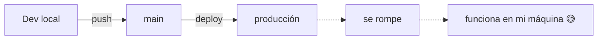
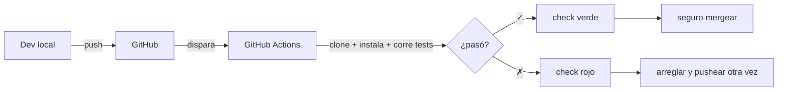
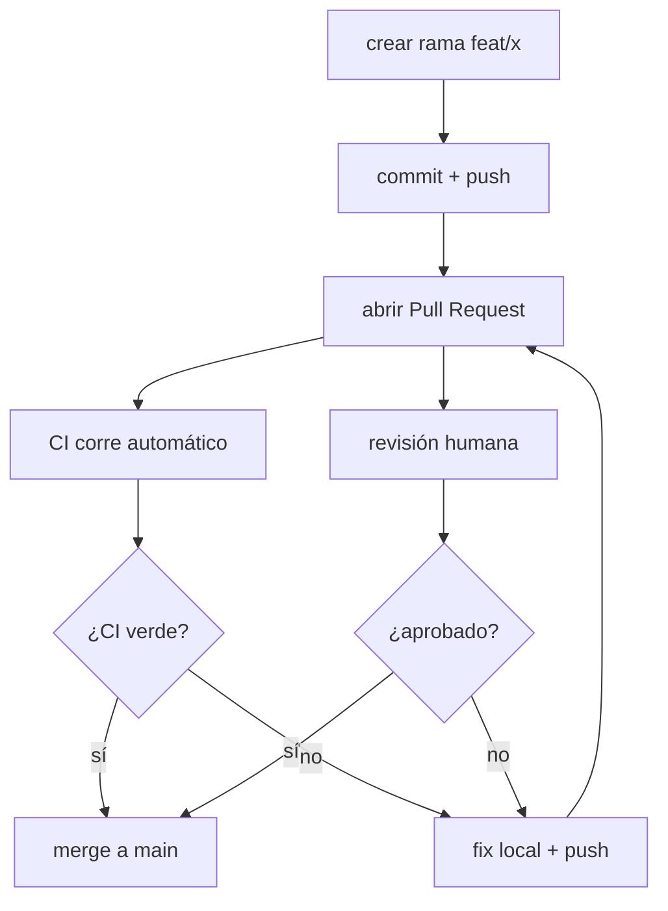

# Tutorial 01b · Construye tu primer repo con CI desde cero

> Pre-requisito: haber leído el [tutorial 01 de git](01-git-flujo-de-trabajo.md). Tener `uv` instalado.

Este tutorial no es sobre este repositorio. Es sobre que tú construyas
uno nuevo, pequeño, desde cero, con integración continua funcionando. Al
terminar vas a entender:

- Qué es CI y por qué todo proyecto que colabora lo usa.
- Qué es un workflow de GitHub Actions y cómo se escribe.
- Qué pasa exactamente cuando abres un Pull Request.
- Cómo el ciclo de desarrollo cambia cuando hay CI en el medio.

Al final tendrás un repositorio con un check verde en cada PR que abras.
Vas a sentir la diferencia entre *"esto me funciona en mi laptop"* y
*"esto funciona de verdad"*.

Dura ~45 minutos la primera vez.

---

## Parte 1 — Teoría (10 minutos de lectura)

### El problema que resuelve CI

Antes de CI, el ciclo de desarrollo en equipos era este:



La frase *"funciona en mi máquina"* existe porque el código que corre en
tu laptop no es exactamente el que corre en el servidor:

- Tienes dependencias instaladas globalmente que no están declaradas en
  el `pyproject.toml`.
- Tienes archivos locales que olvidaste commitear.
- Tienes variables de entorno con valores específicos tuyos.

Cuando empujas a `main` y rompe, descubres estas tres cosas tarde.

### Qué hace CI

**CI (Continuous Integration, Integración Continua)** es un servidor
neutral que ejecuta tu código **cada vez** que haces push o abres un PR.
"Neutral" porque empieza desde cero: sistema operativo limpio, sin tus
variables de entorno, sin tus caches, sin tus dependencias globales. Si
pasa en CI, pasa en una máquina que no es la tuya.



### Dónde encaja en el ciclo de desarrollo

Cuando abres un Pull Request pasan dos cosas en paralelo: una **revisión
humana** y una **revisión automática**. Las dos tienen que pasar antes de
mergear.



Un check verde no sustituye a una revisión humana: el robot verifica que
el código corre, no que esté bien escrito. Y una revisión humana aprobada
no sustituye al robot: el humano puede olvidar que faltó un archivo.

### Por qué todo proyecto serio lo usa

- **Reproducibilidad.** Si un extraño clona tu repo mañana, los tests
  pasan sin pedirte ayuda.
- **Confianza.** Nadie empuja a `main` esperando *"a ver qué pasa"*.
- **Historial.** Cada commit tiene asociado un resultado (verde o rojo).
  Puedes mirar meses atrás y saber en qué commit se rompió algo.
- **Rapidez.** Reemplaza al *"¿me puedes revisar esto antes de que lo
  mergee?"* por un check automático que dura minutos.

---

## Parte 2 — Práctica: construye el tuyo (30 minutos)

Vamos a crear un repositorio nuevo (fuera de este curso) con lo mínimo:
`pyproject.toml`, un test, y un workflow de CI.

### Paso 1 — Crea una carpeta y un repo git local

```bash
mkdir mi-primer-ci
cd mi-primer-ci
git init
```

Verifica:

```bash
git status
# On branch main   (o 'master' según tu config)
# nothing to commit (create/copy files and use "git add" to track)
```

### Paso 2 — Inicia un proyecto con uv

```bash
uv init --package mi_primer_ci
```

Esto crea una estructura básica:

```
mi-primer-ci/
├── .python-version
├── README.md
├── pyproject.toml
└── src/
    └── mi_primer_ci/
        └── __init__.py
```

> Si algún comando pide `python`, `python3` o `py` y uno no te funciona,
> prueba los otros (depende del sistema operativo). Con `uv` instalado,
> esto no te debería pasar casi nunca.

### Paso 3 — Añade pytest como dependencia de desarrollo

```bash
uv add --dev pytest
```

Mira tu `pyproject.toml`. Verás algo así:

```toml
[dependency-groups]
dev = [
    "pytest>=8.0",
]
```

### Paso 4 — Añade un test que pase

Crea `tests/__init__.py` vacío y `tests/test_basico.py`:

```python
def test_matematica_elemental():
    assert 1 + 1 == 2


def test_hola():
    saludo = "hola"
    assert saludo.upper() == "HOLA"
```

Corre los tests localmente para verificar:

```bash
uv run pytest
```

Deberías ver:

```
============================= test session starts =============================
collected 2 items

tests/test_basico.py ..                                                  [100%]

============================== 2 passed in 0.01s ==============================
```

### Paso 5 — Primer commit, pero NO en main

Siguiendo lo del [tutorial 01](01-git-flujo-de-trabajo.md): nunca
trabajes directo en `main`.

```bash
git add .
git commit -m "chore: estructura inicial del proyecto"

# crea una rama para el workflow
git switch -c feat/ci-workflow
```

### Paso 6 — Crea la carpeta `.github/workflows/`

Esta es la convención que GitHub Actions reconoce. Si creas la carpeta con
otro nombre, Actions no la ve.

```bash
mkdir -p .github/workflows
```

Verifica:

```bash
ls -la .github/
# drwxr-xr-x   workflows
```

### Paso 7 — Escribe el workflow

Crea `.github/workflows/ci.yml` con este contenido:

```yaml
name: ci

on:
  push:
    branches: [main]
  pull_request:

jobs:
  test:
    runs-on: ubuntu-latest
    steps:
      - name: Clonar el código
        uses: actions/checkout@v4

      - name: Instalar uv
        uses: astral-sh/setup-uv@v3

      - name: Instalar Python 3.11
        run: uv python install 3.11

      - name: Sincronizar dependencias
        run: uv sync --dev

      - name: Ejecutar los tests
        run: uv run pytest
```

**Línea por línea:**

| Línea | Qué dice |
|---|---|
| `name: ci` | El nombre del workflow como aparece en la pestaña "Actions" de GitHub |
| `on:` | Qué eventos lo disparan |
| `push: branches: [main]` | Se dispara cuando alguien pushea directo a main |
| `pull_request:` | Se dispara cuando alguien abre o actualiza un PR (a cualquier rama) |
| `jobs:` | Qué se corre. Puedes tener varios (test, lint, build) corriendo en paralelo |
| `runs-on: ubuntu-latest` | En qué sistema operativo. Linux es barato y rápido |
| `steps:` | Pasos secuenciales. Cada uno es un comando |
| `uses: actions/checkout@v4` | **Action** publicada por GitHub que clona tu repo en el servidor |
| `uses: astral-sh/setup-uv@v3` | **Action** publicada por el equipo de uv que lo instala |
| `run: uv python install 3.11` | Comando que corre `uv` para instalar Python 3.11 |
| `run: uv sync --dev` | Instala dependencias (incluye las de dev) |
| `run: uv run pytest` | Corre los tests |

Dos conceptos clave:

- **`uses:`** reutiliza una receta publicada por alguien más. Son como funciones.
- **`run:`** ejecuta un comando de shell. Como teclear algo en tu terminal.

### Paso 8 — Commitea el workflow

```bash
git add .github/workflows/ci.yml
git commit -m "feat: anadir workflow de CI"
```

### Paso 9 — Sube el repo a GitHub

En [github.com/new](https://github.com/new) crea un repositorio llamado
`mi-primer-ci` **vacío**: sin README, sin `.gitignore`, sin licencia (el
tuyo local ya los tiene). Luego, desde tu terminal:

```bash
# cambia TU-USUARIO por tu usuario de GitHub
git remote add origin https://github.com/TU-USUARIO/mi-primer-ci.git
git push -u origin main
git push -u origin feat/ci-workflow
```

### Paso 10 — Abre el PR y mira CI correr

En github.com, GitHub te sugerirá un botón **"Compare & pull request"**
desde `feat/ci-workflow`. Haz click, escribe un título y descripción,
dale a **Create pull request**.

Al bajar en el PR verás:

```
Some checks haven't completed yet
🟡 ci / test — Queued
```

Espera ~30 segundos. Luego:

```
All checks have passed
✅ ci / test — Successful in 45s
```

Click en ese link y verás el log paso a paso, con cada `step` y su
salida. Ese es tu workflow corriendo en un servidor de GitHub que **no
es tu máquina**.

### Paso 11 — Rompe el CI a propósito

Vuelve a tu terminal, edita `tests/test_basico.py`:

```python
def test_matematica_elemental():
    assert 1 + 1 == 3   # <-- rota
```

```bash
git add tests/
git commit -m "test: romper el test para ver CI en rojo"
git push
```

Vuelve a GitHub al PR (lo verás actualizado automático):

```
Some checks were not successful
❌ ci / test — Failing after 42s. See details.

[Merge pull request]  <-- aparece bloqueado o con advertencia
```

Click en el link del log. Verás algo así:

```
FAILED tests/test_basico.py::test_matematica_elemental
  assert 1 + 1 == 3
  AssertionError: assert 2 == 3
```

**Ese error lo ve el revisor del PR antes de aprobar o mergear.** No se
mergea sin arreglarlo.

### Paso 12 — Arregla y verifica

```python
def test_matematica_elemental():
    assert 1 + 1 == 2   # <-- arreglada
```

```bash
git add tests/
git commit -m "fix: arreglar test"
git push
```

Nuevo check corre automático. ✅ Verde. **Ahora sí puedes mergear.**

---

## Parte 3 — Qué deberías ver en GitHub (referencia visual)

### En el PR, mientras CI corre:

```
Some checks haven't completed yet
🟡 ci / test — Queued ....... In progress (23s)
```

### Cuando CI pasa:

```
✅ All checks have passed
   ci / test — Successful in 45s

[Merge pull request]  (botón verde)
```

### Cuando CI falla:

```
❌ Some checks were not successful
   ci / test — Failing after 42s. See details.

[Merge pull request]  (botón amarillo con advertencia)
```

### En main, después del merge:

Si navegas al historial de commits (`https://github.com/TU-USUARIO/mi-primer-ci/commits/main`),
cada commit tiene al lado un ✅ o ❌ según el resultado del CI en ese
momento. Puedes navegar a cualquier commit viejo y saber si pasaba.

---

## Lo que acabas de aprender

- Un workflow es un archivo YAML en `.github/workflows/`.
- CI se dispara en `push` y `pull_request` (y otros eventos).
- Un workflow tiene **jobs**, cada job tiene **steps**.
- Un step o reutiliza una **action** publicada (`uses:`) o corre un
  comando (`run:`).
- Un fallo en CI bloquea (o advierte sobre) el merge hasta que lo
  arregles.
- *"Me funciona en mi laptop"* no es suficiente. CI es tu segundo par de
  ojos.

Este patrón es exactamente el que usa `data-projects-lab`. Si abres
[`.github/workflows/ci.yml`](../.github/workflows/ci.yml), verás el
mismo esqueleto con unos steps extra (lint con ruff, smoke test). Nada
mágico.

---

## Siguientes pasos (opcional)

Cuando quieras profundizar:

- **Añade un step de lint** antes de los tests:

  ```yaml
  - name: Lint
    run: uv run ruff check .
  ```

- **Añade una matriz** para correr contra Python 3.10, 3.11 y 3.12 en paralelo:

  ```yaml
  jobs:
    test:
      strategy:
        matrix:
          python-version: ["3.10", "3.11", "3.12"]
      runs-on: ubuntu-latest
      steps:
        - uses: actions/checkout@v4
        - uses: astral-sh/setup-uv@v3
        - run: uv python install ${{ matrix.python-version }}
        - run: uv sync --dev
        - run: uv run pytest
  ```

- **Añade un badge al README** que muestra el estado del CI en tiempo
  real:

  ```markdown
  
  ```

Eso ya es decorado. Lo esencial lo tienes.

---

## Problemas comunes

### "Resource not accessible by integration"

Tu workflow intentó hacer algo que requiere permisos (p. ej. escribir en
el repo, crear releases). Para empezar, mantén el workflow en modo
lectura (es lo que hace el ejemplo).

### El workflow no se dispara

Verifica:

- El archivo está en `.github/workflows/` (no en `.github/` suelto).
- La extensión es `.yml` o `.yaml`.
- El YAML es válido (indentación con espacios, no tabs; una propiedad por línea).

### "No module named 'mi_primer_ci'"

Si tus tests importan de tu paquete, asegúrate de haber corrido
`uv init --package` (no `uv init` solo) para que el `src/` layout esté
bien configurado.
