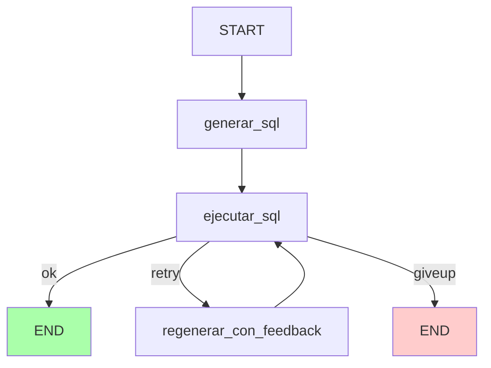

# 15 · LLMs locales y agentes con LangChain + LangGraph

> **Ejemplo aplicado:** este tutorial cubre la **teoría y la receta**; para
> verlo todo junto en un proyecto que convierte preguntas en SQL contra una
> BD real, ve a [`07-chat-con-tu-bd`](../projects/07-chat-con-tu-bd/).

## Índice

1. [¿Qué es un LLM y por qué correrlo local?](#1-qué-es-un-llm-y-por-qué-correrlo-local)
2. [Ollama en 10 minutos](#2-ollama-en-10-minutos)
3. [Elegir modelo: tamaño vs calidad vs hardware](#3-elegir-modelo-tamaño-vs-calidad-vs-hardware)
4. [LangChain: las tres piezas básicas](#4-langchain-las-tres-piezas-básicas)
5. [Tools: dejar que el LLM decida](#5-tools-dejar-que-el-llm-decida)
6. [Cuándo LangChain no basta: LangGraph](#6-cuándo-langchain-no-basta-langgraph)
7. [Seguridad: nunca confíes en lo que genera el LLM](#7-seguridad-nunca-confíes-en-lo-que-genera-el-llm)
8. [Alternativas a Ollama](#8-alternativas-a-ollama)

---

## 1 · ¿Qué es un LLM y por qué correrlo local?

Un **Large Language Model** es una red neuronal gigante (miles de millones de
parámetros) entrenada para predecir la siguiente palabra. Con suficiente
tamaño y datos, surgen capacidades emergentes: resumen, traducción, código,
razonamiento, llamada a herramientas.

**Dos formas de usar un LLM:**

| | API remota (OpenAI, Anthropic, Groq…) | Local (Ollama, llama.cpp) |
|---|---|---|
| Qué mandas | Tu prompt sale de tu máquina. | Nada sale. |
| Costo | Por token. Puede subir rápido. | Gratis después del hardware. |
| Latencia | 100-500 ms (red + servidor). | Depende de tu GPU/CPU. |
| Calidad | Modelos top (GPT-4, Claude Opus). | Modelos open source (Qwen, Llama, Mistral). |
| Offline | No. | Sí. |
| Setup | API key y listo. | Instalar runtime + descargar modelo (4-40 GB). |

**Cuándo correrlo local tiene sentido:**

- **Datos sensibles**: no puedes mandar historias clínicas, nóminas, código
  propietario a un tercero.
- **Volumen alto**: millones de llamadas costarían una fortuna con API.
- **Offline**: entornos sin internet (barco, planta industrial).
- **Experimentación**: prototipar sin preocuparte del costo por request.
- **Aprender**: ves el modelo cargarse, consumir RAM, generar tokens. Entiendes
  mejor qué pasa.

**Los modelos open source de 7B (7.000 millones de parámetros) de 2024-2026
son sorprendentemente capaces.** Para NL → SQL, resumen, extracción, están al
nivel de GPT-3.5. Para razonamiento complejo o código difícil, todavía están
abajo de los frontier models — pero mejoran cada mes.

---

## 2 · Ollama en 10 minutos

[Ollama](https://ollama.com) es como "Docker para LLMs": descarga, corre y expone
un modelo con un comando. Abstrae `llama.cpp` (el motor C++ que corre el modelo)
y te da una API HTTP.

### Instalación

```bash
# macOS
brew install ollama

# Linux
curl -fsSL https://ollama.com/install.sh | sh

# Windows: descarga el .exe de https://ollama.com/
```

### Arrancar el servidor

```bash
ollama serve &
```

Escucha en `http://localhost:11434`.

### Descargar un modelo

```bash
ollama pull qwen2.5:7b          # ~4.4 GB, muy buen all-rounder
ollama pull llama3.1:8b          # ~4.7 GB, el "default" de Meta
ollama pull phi3:mini            # ~2.3 GB, rápido en laptops modestos
```

### Hablar con el modelo

```bash
ollama run qwen2.5:7b "Explica que es SQL en 2 frases"
```

### Desde Python (con LangChain)

```python
from langchain_ollama import ChatOllama

llm = ChatOllama(model="qwen2.5:7b", temperature=0)
r = llm.invoke("¿Cuál es la capital de Colombia?")
print(r.content)
```

---

## 3 · Elegir modelo: tamaño vs calidad vs hardware

Los tamaños se miden en **B** (billion = mil millones de parámetros).

| Modelo | Tamaño | RAM que ocupa* | CPU típica | GPU recomendada |
|---|---|---|---|---|
| `phi3:mini` | 3.8B | ~3 GB | OK en M1/M2 base | opcional |
| `qwen2.5:7b` / `llama3.1:8b` | 7-8B | ~5 GB | lento en CPU puro | 6 GB VRAM |
| `qwen2.5:14b` | 14B | ~9 GB | muy lento | 10 GB VRAM |
| `llama3.1:70b` | 70B | ~40 GB | no viable | GPU 48 GB o 2x24 GB |

*Con cuantización Q4 (el default de Ollama). Cuantización = comprimir los
pesos a menos bits para que quepan en menos RAM; sacrificas algo de calidad.

**Heurística para elegir:**

- **Laptop con 8 GB RAM:** `phi3:mini`.
- **Laptop con 16 GB RAM:** `qwen2.5:7b` o `llama3.1:8b`.
- **Tienes GPU con ≥10 GB VRAM:** `qwen2.5:14b`.
- **Tienes workstation seria (A100 o similar):** `llama3.1:70b`.

**Para tareas estructuradas** (NL→SQL, extracción, clasificación) un 7B es
suficiente. Para razonamiento abierto y código complejo, 14B empieza a notarse.

---

## 4 · LangChain: las tres piezas básicas

LangChain es una librería para componer llamadas a LLMs con otras cosas. Las
tres piezas mínimas:

```python
from langchain_core.prompts import ChatPromptTemplate
from langchain_core.output_parsers import StrOutputParser
from langchain_ollama import ChatOllama

# 1. Prompt
prompt = ChatPromptTemplate.from_messages([
    ("system", "Eres un traductor. Traduce al ingles sin explicacion."),
    ("human", "{texto}"),
])

# 2. Modelo
llm = ChatOllama(model="qwen2.5:7b", temperature=0)

# 3. Parser (extrae el string de la respuesta)
parser = StrOutputParser()

# Las compones con el operador | (LCEL)
cadena = prompt | llm | parser

r = cadena.invoke({"texto": "Hola, ¿cómo estás?"})
print(r)  # "Hello, how are you?"
```

**LCEL (LangChain Expression Language)** es ese operador `|`. Permite encadenar
pasos: cada uno recibe la salida del anterior. Soporta ejecución asincrónica,
streaming y batching sin que cambies el código.

### Patrón típico para "chat con datos"

```python
schema = "tabla productos(id, nombre, precio)"

cadena_sql = ChatPromptTemplate.from_template(
    "Schema:\n{schema}\n\nPregunta: {pregunta}\nDevuelve SOLO el SQL."
) | llm | parser

sql = cadena_sql.invoke({"schema": schema, "pregunta": "producto mas caro"})
# SELECT nombre, precio FROM productos ORDER BY precio DESC LIMIT 1
```

### Recursos del ecosistema que vale la pena conocer

- **`ChatPromptTemplate`**: plantillas de prompt con variables.
- **`StrOutputParser`, `JsonOutputParser`**: extraer strings o JSON de la respuesta.
- **`RunnableLambda`**: meter una función Python en la cadena.
- **Memory**: historial de conversación.
- **Document loaders + text splitters**: para RAG (cargar PDFs y partirlos en chunks).
- **Vectorstores (Chroma, FAISS, pgvector)**: búsqueda semántica para RAG.

---

## 5 · Tools: dejar que el LLM decida

A veces no quieres que el LLM responda siempre con texto. Quieres que **llame a
una función** cuando hace falta (buscar en la BD, consultar una API, enviar un
email).

```python
from langchain_core.tools import tool

@tool
def consultar_productos(categoria: str) -> str:
    """Devuelve los productos de una categoría dada."""
    # ... consulta la BD ...
    return "producto_a, producto_b"

# Le enseñas la tool al LLM
llm_con_tools = llm.bind_tools([consultar_productos])

respuesta = llm_con_tools.invoke("¿Qué productos de electrónica tienen?")
# El LLM NO responde con texto directamente: responde con una "tool call"
# pidiéndote que ejecutes `consultar_productos(categoria="electronica")`.
```

El LLM **decide** si usar la tool o responder directamente. Tú **ejecutas** la
tool cuando te la pide, y le devuelves el resultado para que redacte la
respuesta final.

**Este patrón manual** es lo que un **agente** automatiza: ejecuta la tool,
devuelve el resultado al LLM, y repite hasta que el LLM dé una respuesta
textual final.

---

## 6 · Cuándo LangChain no basta: LangGraph

LCEL es perfecto para tuberías **lineales**:

```
pregunta → prompt → LLM → parser → ejecutar → prompt2 → LLM → respuesta
```

Pero **no** maneja bien:

- **Loops condicionales**: *"si el SQL falla, dale el error al LLM y pide de nuevo"*.
- **Estado compartido**: contador de intentos, SQL previo, error, histórico.
- **Routing condicional**: *"si la pregunta es sobre clientes, ve al agente A; si no, al B"*.
- **Varios agentes colaborando**: planner + executor + critic.

Para esto existe **LangGraph**. La idea: declaras un **grafo de estados** donde:

- Cada **nodo** es una función que lee el estado y lo actualiza.
- Las **aristas** pueden ser **condicionales** (routing basado en el estado).
- Hay un límite de iteraciones para evitar loops infinitos.

### Ejemplo: agente que auto-corrige SQL

```python
from typing import TypedDict
from langgraph.graph import StateGraph, END

# 1. Estado compartido
class State(TypedDict, total=False):
    pregunta: str
    sql: str
    resultado: str | None
    error: str | None
    intentos: int

# 2. Nodos
def generar_sql(state: State) -> dict:
    sql = llm.invoke(f"Genera SQL para: {state['pregunta']}").content
    return {"sql": sql, "intentos": state.get("intentos", 0) + 1}

def ejecutar_sql(state: State) -> dict:
    try:
        resultado = correr_sql(state["sql"])
        return {"resultado": resultado, "error": None}
    except Exception as exc:
        return {"resultado": None, "error": str(exc)}

def regenerar_con_feedback(state: State) -> dict:
    sql = llm.invoke(
        f"El SQL `{state['sql']}` fallo con: {state['error']}. Arreglalo."
    ).content
    return {"sql": sql, "intentos": state["intentos"] + 1, "error": None}

# 3. Routing condicional
def decidir(state: State) -> str:
    if state["error"] is None:
        return "ok"
    if state["intentos"] >= 3:
        return "giveup"
    return "retry"

# 4. Grafo
grafo = StateGraph(State)
grafo.add_node("generar", generar_sql)
grafo.add_node("ejecutar", ejecutar_sql)
grafo.add_node("regenerar", regenerar_con_feedback)

grafo.set_entry_point("generar")
grafo.add_edge("generar", "ejecutar")
grafo.add_conditional_edges("ejecutar", decidir, {
    "ok": END,
    "retry": "regenerar",
    "giveup": END,
})
grafo.add_edge("regenerar", "ejecutar")  # ← aquí está el loop

app = grafo.compile()
final = app.invoke({"pregunta": "productos top", "intentos": 0})
```

Diagrama:



En el proyecto 07 tienes [una implementación completa](../projects/07-chat-con-tu-bd/src/chat_bd/agent_graph.py)
con tests que verifican los tres caminos (feliz, retry, giveup).

### Cuándo LangGraph te paga el costo

- Tu agente necesita **más de un paso** y puede **fallar** en medio.
- Quieres **trazabilidad**: ver qué nodo se ejecutó, en qué orden, con qué estado.
- Quieres **retomar** una conversación desde el estado anterior (usa `checkpointers`).
- Tienes **varios agentes** con roles distintos colaborando.

Si tu caso es *"una pregunta → una respuesta"* sin bucles, **LangChain solo**
ya es suficiente. No metas LangGraph por "modernidad" si no lo necesitas.

---

## 7 · Seguridad: nunca confíes en lo que genera el LLM

El LLM es un generador de texto. **No sabe** si el SQL que acaba de escribir
borra tu base. Tú tienes que poner los filtros.

### Reglas mínimas

1. **Lista blanca de verbos**: para NL→SQL, acepta `SELECT` y `WITH`, rechaza
   todo lo demás.
2. **Una sola sentencia**: si ves `;` en medio, rechaza (previene inyección).
3. **Usuario de BD con permisos mínimos**: si la BD tiene autenticación, el
   usuario del agente debería ser `read-only`.
4. **Timeout**: si una query tarda más de 30 segundos, córtala.
5. **LIMIT por defecto**: si el LLM olvida `LIMIT`, mete uno antes de ejecutar.

Ejemplo de validador (completo en [`07-chat-con-tu-bd/src/chat_bd/sql_tools.py`](../projects/07-chat-con-tu-bd/src/chat_bd/sql_tools.py)):

```python
VERBOS_PROHIBIDOS = {"INSERT", "UPDATE", "DELETE", "DROP", "ALTER", "TRUNCATE"}

def validar(sql: str) -> str:
    primera = sql.strip().split()[0].upper()
    if primera not in {"SELECT", "WITH"}:
        raise ValueError(f"Solo lectura. Verbo: {primera}")
    for verbo in VERBOS_PROHIBIDOS:
        if re.search(rf"\b{verbo}\b", sql, re.IGNORECASE):
            raise ValueError(f"Verbo prohibido: {verbo}")
    if ";" in sql.rstrip(";"):
        raise ValueError("Solo una sentencia")
    return sql
```

Esto rechaza incluso `SELECT 'DELETE' FROM productos` (falso positivo). Es el
tradeoff conservador correcto: prefiere molestar al usuario a borrar la BD.

---

## 8 · Alternativas a Ollama

Si Ollama no te sirve (hardware, Windows antiguo, prefieres la nube), aquí
están las alternativas con sus tradeoffs.

| Opción | Modelo típico | Costo | Latencia | Pro/Contra |
|---|---|---|---|---|
| **Ollama local** | Qwen 2.5 7B, Llama 3.1 8B | Gratis (hardware) | 5-30s/respuesta | Offline, privado, lento en CPU |
| **HuggingFace Inference API** | Mismos modelos open source | Free tier limitado | 2-10s | Zero setup, rate-limited |
| **Groq** | Llama 3.1 70B, Mixtral | Free tier generoso | <1s (ultra rápido) | Dependes de su infraestructura |
| **Together AI** | Muchos open source | Pay-per-token barato | 1-3s | Similar a OpenAI pero con open source |
| **DeepSeek API** | DeepSeek Chat/Coder | Muy barato | 1-3s | API china, revisa data policies |
| **OpenAI / Anthropic** | GPT-4, Claude | Caro (pay-per-token) | 1-3s | Calidad top, datos van al proveedor |

**Para el curso**, Ollama local es la mejor combinación: cero costo, cero
dependencias de terceros, enseña el concepto completo. Si tu máquina no da,
HuggingFace Inference API es el fallback más fácil (y es lo que el proyecto 07
soporta cambiando `LLM_PROVIDER=hf` en `.env`).

---

## Referencias

- Ollama: <https://ollama.com>
- LangChain docs: <https://python.langchain.com/docs/>
- LangGraph docs: <https://langchain-ai.github.io/langgraph/>
- Comparativa de modelos open source: <https://huggingface.co/spaces/open-llm-leaderboard/open_llm_leaderboard>
- Proyecto del curso donde todo esto está implementado:
  [`07-chat-con-tu-bd`](../projects/07-chat-con-tu-bd/)
